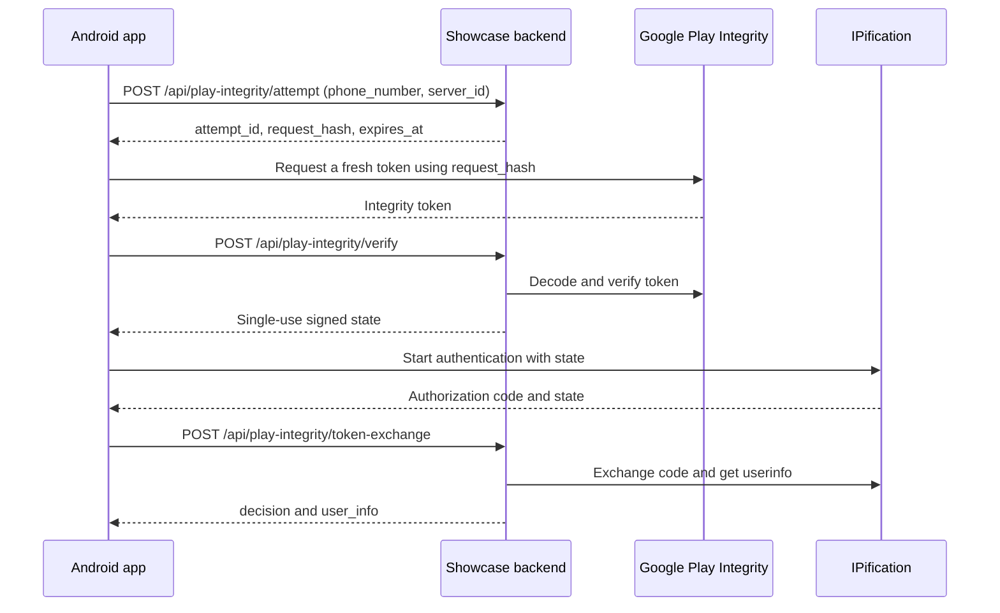

# Play Integrity backend demo

> [Documentation home](INDEX.md) · [Integration guide](integration/README.md) · [HTTP reference](integration/api.md)

This demo verifies an Android Play Integrity token on the server at
`POST /api/play-integrity/verify`. Verification is mandatory; missing configuration or Google verification failure does not produce a verified state.

For the complete Android-to-IPification flow, use the three endpoints in this
order: create a short-lived attempt, verify its fresh Play Integrity token,
then exchange the IPification authorization code. The attempt and its
server-side snapshot are the source of truth for the operation.

## Flow overview



These are Showcase endpoints. The Android application is not included in this repository; the Kotlin snippets illustrate the integration boundaries and require an Android SDK setup of your own.

## Attempt, verification, and token exchange

### 1. Create an attempt

Android sends both required fields; `server_id` is mandatory:

```http
POST /api/play-integrity/attempt
Content-Type: application/json

{
  "phone_number": "<e164-phone-number>",
  "server_id": "<configured-server-id>"
}
```

The backend selects the client configured for `PLAY_INTEGRITY_USER_FLOW` and the requested server, normalizes the phone
number, stores an immutable attempt snapshot, and computes the request hash.
It returns only public values:

```json
{
  "attempt_id": "<attempt-id>",
  "request_hash": "<backend-returned-request-hash>",
  "expires_at": "<iso-8601-expiry>"
}
```

Android must use the returned `request_hash` verbatim. It must not recreate or
modify the hash from client-provided values.

### 2. Request a fresh token and verify it

Request a fresh Standard Integrity token for every attempt, using the exact
backend-returned hash. Never cache, log, or reuse an integrity token:

```kotlin
val token = integrityTokenProvider.request(
  StandardIntegrityTokenRequest.builder()
    .setRequestHash(attempt.request_hash)
    .build()
).await().token()
```

Send it once to the backend:

```http
POST /api/play-integrity/verify
Content-Type: application/json

{
  "attempt_id": "<attempt-id>",
  "integrity_token": "<fresh-token-from-android>"
}
```

The backend atomically changes the attempt from `created` to `verifying`,
decodes the token, checks package name, hash, freshness, and configured app /
device / licensing policy, then marks it approved and creates a single-use
transaction. A successful HTTP 201 response contains:

```json
{
  "state": "<signed-state>",
  "expires_at": "<iso-8601-expiry>"
}
```

Expired, claimed, or rejected attempts cannot be verified again. A failed
verification returns no state.

### 3. Set state before IPification and exchange the code

Android must set the returned state before starting IPification:

```kotlin
ipificationSdk.setState(state)
ipificationSdk.startAuthentication()
```

When IPification returns an authorization code and state, send both unchanged:

```http
POST /api/play-integrity/token-exchange
Content-Type: application/json

{
  "code": "<authorization-code>",
  "state": "<signed-state>"
}
```

The backend verifies and atomically consumes the transaction before exchanging
the code with IPification. A successful response contains the decision and
the user information returned by IPification:

```json
{
  "decision": "allow",
  "user_info": { "sub": "<user-subject>" }
}
```

Token details are not returned. The signed state and transaction are
single-use; replay or expiry is rejected.

## Configuration

Copy the safe examples from `.env.example` into `.env.local` or the deployment environment and
set the package name to the Android application ID:

```dotenv
PLAY_INTEGRITY_PACKAGE_NAME=com.example.demo
GOOGLE_APPLICATION_CREDENTIALS=/run/secrets/play-integrity-service-account.json
PLAY_INTEGRITY_REQUIRE_LICENSED_APP=false
PLAY_INTEGRITY_USER_FLOW=pvn_ip
PLAY_INTEGRITY_STATE_SECRET=<long-random-secret>
PLAY_INTEGRITY_STATE_ISSUER=showcase
PLAY_INTEGRITY_STATE_AUDIENCE=showcase-app
```

Verification does not depend on the request hostname. Missing Play Integrity settings make these endpoints unavailable without blocking unrelated flows.

The authorization code and redirect URI must correspond to the configured client used for the attempt. The Play Integrity code exchange uses the generic mobile-style grant and does not have the browser flow’s backend-stored nonce or ID-token and subject checks. See [Mobile and S2S](integration/mobile-s2s.md).

The Google Cloud project used by the backend must be linked to the matching
application in Google Play Console. Enable the Play Integrity API in that
project, and grant the runtime identity permission to call it (for example,
the least-privilege Play Integrity API user role). The package name in
`PLAY_INTEGRITY_PACKAGE_NAME`, the Play Console app, and the Android build must
match exactly.

For local or secret-mounted deployments, Google Application Default
Credentials (ADC) may read the service-account JSON from
`GOOGLE_APPLICATION_CREDENTIALS`. In a managed deployment, prefer workload
identity or the platform's attached service account so no key file is needed.
Never commit a service-account key, access token, Android integrity token, or
decoded Google response. Do not put any of these values in `.env.example`, test
fixtures, client code, URLs, or logs.

`PLAY_INTEGRITY_REQUIRE_LICENSED_APP=true` additionally requires the
`LICENSED` app-licensing verdict. Leave it `false` for the basic demo unless
the distribution and licensing requirement has been configured in Play.

## Android provider lifecycle

On Android, prepare the Standard Integrity token provider with the same Google
Cloud project number before requesting a token. Keep the prepared provider in
memory and use it for requests rather than preparing it for every button tap.
Warm the provider during app startup or before the protected action, then
request a token for each action. If the provider reports that it is invalid or
expired, discard it, prepare a new provider, and retry the token request once
after the warm-up succeeds. Follow the Android Play Integrity SDK result and
error callbacks for renewal; do not retry indefinitely or reuse an old token.

For example, prepare a provider ahead of the protected action:

```kotlin
val manager = IntegrityManagerFactory.createStandard(applicationContext)
manager.prepareIntegrityToken(
  PrepareIntegrityTokenRequest.builder()
    .setCloudProjectNumber(CLOUD_PROJECT_NUMBER)
    .build()
).addOnSuccessListener { provider ->
  integrityTokenProvider = provider
}
```

See Google's [Standard API guide](https://developer.android.com/google/play/integrity/standard) for Android dependencies, imports, callbacks and error handling.

## Request hash protocol

The backend computes the request hash from the immutable attempt snapshot:

```text
base64url(SHA-256(UTF-8(action + "\n" + canonicalJson(payload))))
```

`canonicalJson` sorts object keys recursively, preserves array order, and emits
compact JSON without whitespace. Numbers must be finite; unsupported values
and circular structures are rejected. Android must use the backend-returned
hash verbatim in the Standard Integrity request. The verify request contains
only `attempt_id` and the resulting token; the client never supplies the action,
phone number, or expected hash.

## Verify the demo endpoint

Use a fresh integrity token obtained from the Android app. Replace placeholders
locally and do not paste real tokens, authorization codes, signed states, or
phone numbers into source control or documentation:

```bash
curl --request POST "http://localhost:3002/api/play-integrity/verify" --header "Content-Type: application/json" --data '{"attempt_id":"<attempt-id>","integrity_token":"<fresh-token-from-android>"}'
```

The successful response contains only:

```json
{
  "state": "<signed-state>",
  "expires_at": "<iso-8601-expiry>"
}
```

A successful response is HTTP 201. A policy denial is HTTP 403 and includes
safe reason codes such as `REQUEST_HASH_MISMATCH`, `APP_NOT_RECOGNIZED`,
`DEVICE_INTEGRITY_NOT_MET`, or `APP_NOT_LICENSED`. Invalid input returns 400;
an expired or already used attempt returns 409; Google credential, network, or
timeout unavailability returns 503. An IPification code exchange failure returns 401. The API does not return the submitted
token, bearer credential, decoded `tokenPayloadExternal`, or raw Google
response.

Request-level operational logs should be limited to the request ID, endpoint,
decision, reason codes, and duration. Never log phone numbers or other PII,
request bodies, integrity tokens, authorization codes, signed states,
credentials, client secrets, or decoded verdict payloads.

## TTL and storage boundary

Attempts expire after 120 seconds; an approved transaction shares the original
attempt deadline. The signed state also has a 120-second lifetime, but cannot
extend that transaction deadline.

The built-in storage is in-memory and process-local; it is not shared across
instances and a restart clears all state. Deployments requiring shared or durable
state need storage supporting atomic claim and consume operations. Production
integrations must also bind the attempt and signed state to an authenticated
user session or a short-lived verification session. An unguessable `attempt_id`
alone is not an authenticated credential.

## Android verification checklist

Run this checklist only with non-production credentials and a Play-installed
test build. It is intentionally recorded as a manual procedure; it has not
been run in this repository without Android credentials and a linked Play
application.

- [ ] Link the Google Cloud project to the Play Console application and enable
      the Play Integrity API.
- [ ] Configure ADC or workload identity for the backend without committing a
      key file.
- [ ] Confirm the Android package name equals `PLAY_INTEGRITY_PACKAGE_NAME`.
- [ ] Warm the Android provider and renew it when the SDK reports invalid or
      expired state.
- [ ] Set `PLAY_INTEGRITY_USER_FLOW` to a configured flow (for example, `pvn_ip`).
- [ ] Create an attempt with `phone_number` and `server_id`; confirm
      HTTP 201 returns `attempt_id`, `request_hash`, and `expires_at`.
- [ ] Request a fresh token using that exact backend-returned `request_hash`,
      then POST `attempt_id` and `integrity_token` to `/verify`; confirm HTTP 201
      returns a signed `state` and `expires_at`.
- [ ] Call `setState(state)` before `startAuthentication()`, then POST the
      returned authorization `code` and unchanged `state` to
      `/token-exchange`; confirm HTTP 200 with `decision: "allow"`.
- [ ] Create two attempts, request a fresh token for the first, and submit it
      once against the second attempt; confirm HTTP 403 with
      `REQUEST_HASH_MISMATCH`. Do not submit that token again.
- [ ] Confirm logs contain only request ID, decision, reason codes, and
      duration, with no token, credential, request body, or decoded response.

## Source and tests

- [Routes](../src/modules/play-integrity/routes.ts), [handler](../src/modules/play-integrity/handlers.ts), and [service](../src/modules/play-integrity/service.ts).
- [Attempt lifecycle and hash](../src/modules/play-integrity/attempts.ts) and [Google verification](../src/modules/play-integrity/verifier.ts).
- [API contracts](../tests/contracts/integrity.test.ts) and [service tests](../tests/services/integrity.test.ts). Tests use simulated provider responses; a real Android/Google Play verification requires the manual setup above.
