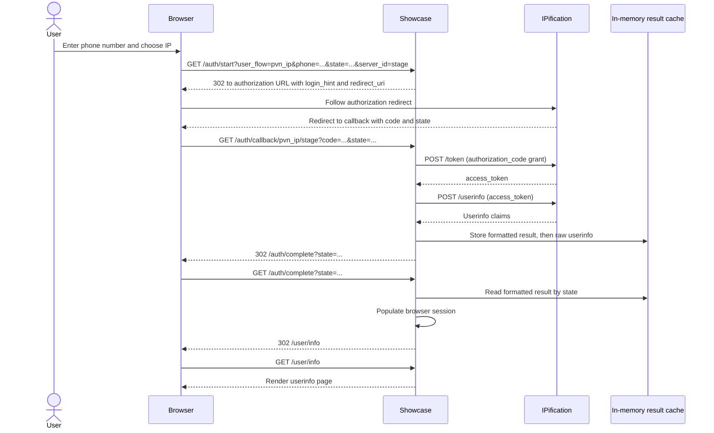

# Phone Number Verification (PNV) via IP

> A separate Next.js application is being migrated in `showcase-next/`. See the [migration guide](NEXTJS_MIGRATION.md) for its runtime configuration, commands, compatibility limits and verification. The existing Express application remains available.


This guide follows the implemented IP verification flow: enter a phone number, redirect the browser to IPification, receive an authorization code, fetch userinfo, and display the result in a browser session.

The UI calls this feature **PNV**, while its configured flow identifier is **`pvn_ip`**. Keep that identifier when configuring clients or calling the routes.

This describes the current Showcase implementation. A completed browser session and a successful phone-verification result are separate concepts; see [Verification results and current limitations](#verification-results-and-current-limitations).

## Scope and configuration

The primary walkthrough is the mobile web flow, where the browser follows redirects directly. Desktop IP verification uses a QR code and the same backend callback; see [Desktop QR variant](#desktop-qr-variant). SIM/TS43, SMS OTP, native mobile login, and Android Play Integrity have separate entry points and are not part of this walkthrough.

A configured client must have `user_flow: "pvn_ip"` and the appropriate scope. The following is an illustrative configuration fragment; replace every placeholder with your own values:

```json
{
  "realm": "ipification",
  "auth_servers": [
    { "id": "stage", "url": "https://auth.example.test/auth" }
  ],
  "client_id": "<client-id>",
  "client_secret": "<client-secret>",
  "clients": [
    {
      "user_flow": "pvn_ip",
      "title": "IP Phone Number Verification",
      "scope": "openid ip:phone_verify"
    }
  ]
}
```

Client-specific credentials override the shared credentials. Otherwise, request locals supply the shared values. Register the exact callback URL for your application origin and selected server, for example:

```text
https://showcase.example.test/auth/callback/pvn_ip/stage
```

Sources: [sample configuration](../config/default.json.sample), [request locals](../middleware/appLocals.js), [configuration reference](CONFIG_DEFAULT_JSON_SAMPLE.md), and [local setup](QUICKSTART.md).

## End-to-end sequence



The carrier-side verification itself is outside this repository. The code here builds the authorization request and consumes the token/userinfo responses; it does not implement the provider's internal verification process.

## 1. Enter a phone number and choose IP

The PNV section renders a phone input and an IP button with `data-user-flow="pvn_ip"`. The browser click handler:

1. Reads and validates the number using `intl-tel-input` (the existing `999` test dial code bypasses invalid-number rejection).
2. Removes spaces and the leading `+` from the submitted number.
3. Reads the selected auth server.
4. Generates a state value and navigates to `/auth/start` on mobile.

For example, an entered `+1 202-555-0123` is submitted as `12025550123` after the input library formats it. An illustrative request is:

```http
GET /auth/start?user_flow=pvn_ip&server_id=stage&phone=12025550123&state=example-state
```

`example-state` is a placeholder for explanation, not a recommended production state value. The current frontend generates state with `randomstring(10)`. The UI requires a phone number for this PNV flow; the backend `/auth/start` handler itself does not enforce a phone-number requirement or repeat the frontend number validation.

Sources: [PNV input and buttons in `login.pug`](../views/login.pug), [button handler and `randomstring` in `login.js`](../public/js/login.js).

## 2. Build the authorization URL and redirect

The `start` handler resolves `server_id` and finds the client by `user_flow`. If `server_id` is omitted, it uses the first configured server. The auth service then builds this endpoint:

```text
{auth_server.url}/realms/{realm}/protocol/openid-connect/auth
```

The request includes `response_type=code`, `client_id`, `scope`, `redirect_uri`, the browser's `state`, a generated `nonce`, and the existing locale/consent/environment fields. The phone parameter becomes `login_hint`:

```js
// Excerpts from services/authService.js
redirect_uri: `${baseUrl}/auth/callback/${userFlow}/${server.id}`,
// ...
if (phone) params.login_hint = phone;
```

The backend sends HTTP 302, and the browser follows the authorization URL. For `pvn_ip`, the scope comes from configuration, normally `openid ip:phone_verify`.

The callback origin is derived from the incoming request's protocol and Host header through `res.locals.baseUrl`. Use the intended public origin when testing redirects and configuring the provider.

Sources: [`start` in `webHandlers.js`](../routes/auth/webHandlers.js), [`buildAuthorizationUrl` in `authService.js`](../services/authService.js), [`createAppLocalsMiddleware`](../middleware/appLocals.js).

## 3. Receive the provider callback

After the provider flow, the browser reaches the callback URL with an authorization code and state:

```http
GET /auth/callback/pvn_ip/stage?code=example-code&state=example-state
```

Both path segments, `userFlow` and `serverId`, are required by the registered route. The callback resolves the selected server and configured client again. If the provider returns `error` or `error_description`, it stores a fixed user-facing error message in the session and redirects to `/auth/login`.

The code is exchanged by the backend in the following steps; the browser does not perform the token request.

Sources: [route registration](../routes/auth.js), [`callback` and `CALLBACK_ERROR_MESSAGES` in `webHandlers.js`](../routes/auth/webHandlers.js).

## 4. Exchange the code for an access token

The callback calls `exchangeAuthorizationCode` with the selected server, realm, client credentials, code, and the callback URI. The token endpoint is:

```text
{auth_server.url}/realms/{realm}/protocol/openid-connect/token
```

The backend POSTs form-encoded fields:

```text
code=example-code
redirect_uri=https://showcase.example.test/auth/callback/pvn_ip/stage
grant_type=authorization_code
client_id=<client-id>
client_secret=<client-secret>
```

The fields above are shown one per line for readability; the actual body is URL-encoded. For example, this reproduces the request shape with placeholders:

```bash
curl 'https://auth.example.test/auth/realms/ipification/protocol/openid-connect/token' \
  --data-urlencode 'code=<authorization-code>' \
  --data-urlencode 'redirect_uri=https://showcase.example.test/auth/callback/pvn_ip/stage' \
  --data-urlencode 'grant_type=authorization_code' \
  --data-urlencode 'client_id=<client-id>' \
  --data-urlencode 'client_secret=<client-secret>'
```

These calls are normally made by Showcase. The example is for inspecting the contract, not an additional step after Showcase has exchanged the same code.

Sources: [`exchangeAuthorizationCode`](../services/authService.js), [`exchangeCodeForToken`](../utils/httpClient.js).

## 5. Fetch userinfo with the access token

The HTTP client takes `access_token` from the token response, then POSTs it as a form field to the userinfo endpoint:

```text
POST {auth_server.url}/realms/{realm}/protocol/openid-connect/userinfo
Content-Type: application/x-www-form-urlencoded

access_token=<access-token>
```

This implementation passes the token in the form body. An illustrative userinfo response is:

```json
{
  "sub": "example-subject",
  "phone_number": "+12025550123",
  "phone_number_verified": "true"
}
```

Actual claims and value types depend on the provider response. Showcase stores and displays the returned userinfo without normalizing `phone_number_verified`.

Source: [`exchangeCodeAndGetUserInfo` and `getUserInfo`](../utils/httpClient.js).

### Client integration: decide whether phone verification succeeded

If you are integrating your application with IPification, a successful userinfo request is not enough to mark the phone number as verified. After retrieving userinfo, check `phone_number_verified` before completing your application's authentication flow:

- **`true`**: Phone verification succeeded; continue the successful authentication flow.
- **`false`**: Phone verification failed. Return a verification error or direct the user to another authentication method, such as SMS OTP, according to your application's flow.
- **Missing or an unrecognized value**: Verification is not confirmed; handle it as an unsuccessful result rather than granting access.

Perform this decision in your integrating backend before creating an authenticated application session or issuing an application token. Match the claim's representation to your provider contract. This illustrative function explicitly accepts boolean `true` and the string `'true'`, while rejecting boolean `false`, the string `'false'`, and missing values:

```js
// Example integration logic; this is not currently applied by the Showcase web flow.
function evaluatePnvResult(userInfo) {
  const verified = userInfo?.phone_number_verified === true
    || userInfo?.phone_number_verified === 'true';

  if (!verified) {
    return { success: false, error: 'PHONE_NUMBER_NOT_VERIFIED' };
  }

  return { success: true, phoneNumber: userInfo.phone_number };
}
```

The caller can turn the unsuccessful result into an error response or start the alternative authentication flow. Avoid a truthiness check such as `if (userInfo.phone_number_verified)`: the string `'false'` is truthy in JavaScript.

This is the integration rule for deciding PNV success. The following steps describe how Showcase currently caches and displays the response; its ordinary web flow does not apply this claim check before setting the demo session flag.

## 6. Store the callback result

The callback creates a display result and saves two entries, in this order:

| Cache key | Value | Consumer |
| --- | --- | --- |
| `{state}` | `{ userInfo: prettyHtml(userInfo), client_id, client_title, state }` | Browser session completion |
| `{state}-user-info` | Raw userinfo object | `/auth/s2s/signin` |

Both writes finish before the callback redirects or notifies a QR client. The current store is process-local memory with a default TTL of one hour. Reads do not consume the entries; a process restart loses them.

An ordinary web callback then redirects to:

```text
/auth/complete?state=example-state
```

Sources: [`callback`](../routes/auth/webHandlers.js), [`saveResult`](../services/authResultStore.js), [cache initialization](../lib/data_store.js).

## 7. Complete the browser session and display userinfo

The `complete` handler looks up the formatted result by state. It polls up to five times and waits one second after every miss, including the final miss. When a result is found, it executes:

```js
req.session.isAuthenticated = true;
req.session.userData = response;
res.redirect('/user/info');
```

If no result is found, it redirects to `/`. The root route redirects to `/auth/login`.

`GET /user/info` checks `req.session.isAuthenticated`, then renders the stored HTML-formatted userinfo. It is a demo result page, not a separate phone-verification decision.

Sources: [`waitForResult`](../services/authResultStore.js), [`complete`](../routes/auth/webHandlers.js), [root redirect](../routes/index.js), [user info route](../routes/user.js), [result template](../views/info.pug).

## Desktop QR variant

On desktop, selecting IP displays a QR code instead of immediately redirecting that browser. The QR link contains the same `/auth/start` parameters, with state shaped as `<random>-qrcode`.

The phone scans the link and completes the provider flow. The backend callback still exchanges the code, fetches userinfo, and writes both cache entries. It then emits:

```js
// Socket.IO room: auth:<state>; event: messages
{ event_name: 'url', url: '<baseUrl>/auth/complete?state=<state>' }
```

The desktop receives the URL, navigates to `/auth/complete`, and adopts the result into its own browser session. The phone is redirected to `/auth/qrcode/error` only when `userInfo.phone_number_verified === 'false'`; otherwise it goes to `/auth/qrcode/complete`. That comparison is specifically against the string `'false'`, not boolean `false`.

A callback carrying `ip-backchannel-im-auth: true` takes precedence over the QR branch and returns an empty HTTP 200 after storing the result. That branch supports the backchannel flow rather than the ordinary IP browser walkthrough.

Sources: [`showQrcodeWithLink` and click handling](../public/js/login.js), [desktop socket listener](../public/js/socket.js), [socket room setup](../socket.js), [`handleQrCodeCallback` and `callback`](../routes/auth/webHandlers.js).

## Verification results and current limitations

These points describe the current standard web flow, not the separate signed-state mechanism used by Android Play Integrity:

- **State correlates results, but is not checked against a saved browser-session value.** The frontend generates it; `/auth/start` checks that it is present and forwards it. The callback does not compare the returned state to an original value saved in the session. If callback state is absent, it generates a UUID. The result cache is then keyed by that state. Do not describe this implementation as completed CSRF state validation.
- **Code exchange and userinfo retrieval do not by themselves constitute the application's phone-verification decision.** The provider returns the claims, but the ordinary web callback does not require `phone_number_verified` to be true, compare the returned phone to the submitted phone, or validate an ID token locally before storing the result.
- **`isAuthenticated` marks the demo browser session.** `/auth/complete` sets it when a cached display result is found. It does not independently check `phone_number_verified`. The result page can therefore display a failed or missing verification claim even though the session flag is true.
- **The QR result-page check is narrower.** It checks the string `'false'` only; it is not a general normalization or validation of the provider's verification claim.

An integrating application needs an explicit decision about the returned verification claims before granting access or treating a phone number as verified. This guide documents existing behavior and does not change it.

## Failure paths

| Stage | Current response or behavior |
| --- | --- |
| Phone missing/invalid in the PNV UI | Show the relevant input modal; do not start the redirect |
| Unknown `server_id` at `/auth/start` | HTTP 400 JSON `{ "error": "INVALID_SERVER_ID" }` |
| No server configured at `/auth/start` | HTTP 400 JSON `{ "error": "NO_AUTH_SERVERS_CONFIGURED" }`; normal app startup also validates configuration |
| Unknown `user_flow` at `/auth/start` or callback | Plain-text `Client not found` with the existing default HTTP 200 |
| State missing at `/auth/start` after server/client resolution | Redirect to `/auth/login` |
| Provider reports callback `error` or `error_description` | Save a fixed session error message and redirect to `/auth/login` |
| Unknown callback server | HTTP 400 text describing the invalid server ID |
| Token exchange/userinfo request fails in the callback | HTTP 400 containing the caught error message |
| Completion cache misses on all attempts | Redirect to `/`, then the login page |

The fixed provider-error mapping and the token-request failure response are different paths. The callback does not redirect every error to login.

## Code and test map

| Step | Implementation | Regression coverage |
| --- | --- | --- |
| Phone input, number formatting, mobile/QR branch | [`login.pug`](../views/login.pug), [`login.js`](../public/js/login.js) | Frontend behavior described from source; not covered by the backend tests below |
| Resolve credentials/server and build authorization URL | [`appLocals.js`](../middleware/appLocals.js), [`authService.js`](../services/authService.js) | [`appLocals.test.js`](../test/middleware/appLocals.test.js), [`authService.test.js`](../test/services/authService.test.js), [`authFlows.test.js`](../test/routes/authFlows.test.js) |
| Callback, cache writes, QR notification, session completion | [`webHandlers.js`](../routes/auth/webHandlers.js), [`authResultStore.js`](../services/authResultStore.js) | [`authFlows.test.js`](../test/routes/authFlows.test.js), [`authResultStore.test.js`](../test/services/authResultStore.test.js) |
| Provider error mapping | [`webHandlers.js`](../routes/auth/webHandlers.js) | [`authSecurity.test.js`](../test/routes/authSecurity.test.js) |

The backend tests use local provider fixtures. They establish request/response behavior and ordering, not live carrier verification or a deployed end-to-end browser flow.
