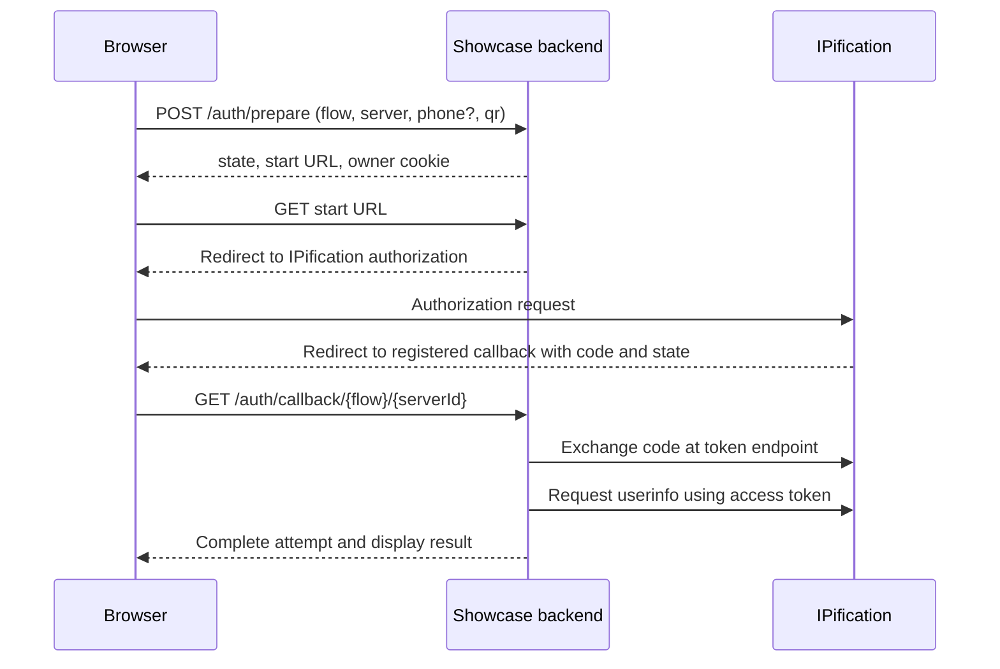

# Browser authorization: PNV, Login and Identity

[Documentation home](../README.md) · [QR](qr.md) · [Source map](../reference/source-map.md)

## Choose the flow

| Goal | Showcase `user_flow` | Input |
| --- | --- | --- |
| Verify an entered number | `pvn_ip`, `pvn_ip_plus`, `pvn_im`, `pvn_ipificator` | Phone, sent as `login_hint` |
| Log in | `login_ip`, `login_ip_plus`, `login_im` | No phone entered in this UI |
| Obtain anonymous identity | `anonymous` | No phone |
| Request KYC data | `kyc_phone` | Phone |

Available products, scopes and channels depend on your configuration. IP via App uses a distinct IPificator endpoint. SMS and SIM follow separate flows: [SMS](sms.md), [SIM](sim.md). See [flow catalog](../../src/shared/flow-catalog.ts) and [provider URL builder](../../src/server/auth/provider.ts).

## Request sequence



1. Configure the provider server and client. Register the exact callback used in both authorization and token exchange: `{origin}/auth/callback/{userFlow}/{serverId}` for this showcase.
2. The browser asks the showcase to prepare a short-lived attempt. Keep its owner cookie and returned URL on the same origin. These are showcase-specific operations.
3. The showcase builds an authorization URL with `response_type=code`, `client_id`, `redirect_uri`, `scope`, `state`, `nonce`, and optional `login_hint`/`channel`, plus demo configuration parameters. It redirects the browser to the provider.
4. On callback, the backend validates its attempt and binding, handles provider errors, exchanges the code using the same redirect URI, and fetches userinfo. Client secrets remain on the backend.
5. The showcase stores a result and creates a display session. The fields in userinfo depend on the provider and granted scope.

For example, this request is to the **showcase**, not IPification:

```http
POST /auth/prepare HTTP/1.1
Content-Type: application/json

{"user_flow":"pvn_ip","server_id":"stage","phone":"+<country-code><number>","qr":false}
```

A successful response is HTTP 201 with `state`, `url` and `expiresAt`, plus an HttpOnly owner cookie. Follow the returned `url`; do not invent a state or start URL. Errors include invalid input or server selection; storage failure can return 503. See [handler](../../src/server/auth/web.ts), [attempt repository](../../src/server/auth/attempts.ts), and [HTTP reference](../reference/http.md).

## Provider endpoints and response

For the standard browser flow the configured root is `{auth_server.url}/realms/{realm}/protocol/openid-connect`. The app redirects to `/auth`, posts the code to `/token` using `openid-client` with client authentication, then sends the access token as Bearer to `/userinfo`. The callback URI in the token request must match the one used at authorization. The IPificator flow uses a separate authorization endpoint. [Provider code](../../src/server/auth/provider.ts) · [Token and userinfo client](../../src/server/shared/http-client.ts)

The following illustrates the provider-side requests. Values must be URL-encoded and supplied by your configuration; `<oidc-root>` is the configured root described above. Use a backend OIDC library and never send the client secret to the browser.

```http
GET <oidc-root>/auth?response_type=code&client_id=<client-id>&redirect_uri=<encoded-callback>&scope=<encoded-scope>&state=<state>&nonce=<nonce>&login_hint=<encoded-phone>
```

```http
POST <oidc-root>/token HTTP/1.1
Content-Type: application/x-www-form-urlencoded

grant_type=authorization_code&code=<code>&redirect_uri=<encoded-callback>&client_id=<client-id>&client_secret=<client-secret>
```

```http
GET <oidc-root>/userinfo HTTP/1.1
Authorization: Bearer <access-token>
```

The `login_hint` is omitted for flows without a phone; other configured parameters may also be present. These examples illustrate the showcase's request shape, not complete callback validation or a production-ready client implementation. The CIBA SMS/SIM code uses its own provider request path; see the respective guides.

Illustrative userinfo, not a guaranteed response:

```json
{"sub":"<subject>","phone_number_verified":true}
```

Do not infer successful phone verification from the existence of a session or a userinfo response. `phone_number_verified` can be absent; absence is not `true`. Apply the provider's documented claim semantics and your own policy. Provider errors and expired or used codes require appropriate error handling; start a fresh attempt instead of replaying a code.

## Integration and security boundaries

The showcase uses `openid-client` for code exchange and userinfo but constructs its own authorization request. Its browser flow does **not** implement PKCE or validate the ID token. It generates a nonce but does not validate it against an ID token; it calls userinfo with `skipSubjectCheck`. Do not treat this as a complete OIDC implementation. In your application use an appropriate OIDC client and provider-supported protections, validate callback/state and redirect URI, and validate ID tokens and expected subject where applicable. Use HTTPS and server-side secret handling. The demo's sessions, result cache and routes are implementation choices; adopt your application's session and authorization model.

Follow [UI preparation](../../src/features/login/use-verification.ts) → [web handlers](../../src/server/auth/web.ts) → [auth service](../../src/server/auth/service.ts) → [provider](../../src/server/auth/provider.ts) → [HTTP client](../../src/server/shared/http-client.ts). The [contract tests](../../tests/contracts/web-auth.test.ts) use a mock provider and do not establish real carrier or provider behavior.
