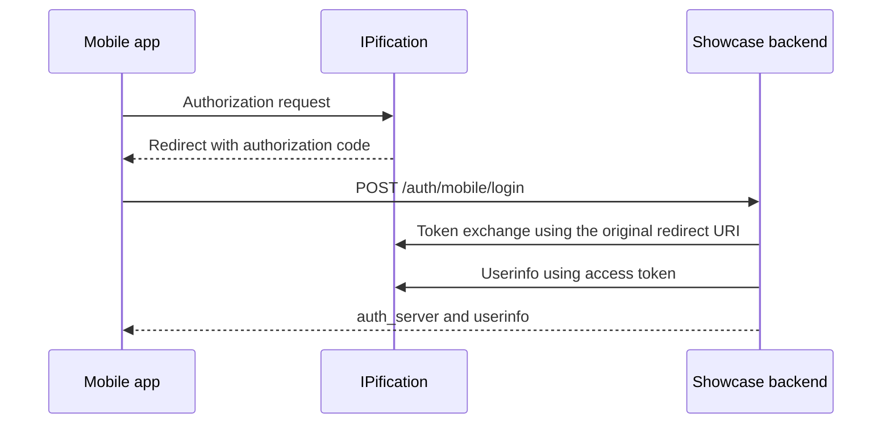

# Mobile code exchange and S2S lookup

[Documentation home](../README.md) · [Showcase HTTP reference](../reference/http.md)

Choose by the information you have:

| You have | Showcase operation | What happens |
| --- | --- | --- |
| An unused authorization `code` and its exact redirect URI | `POST /auth/mobile/login` | Exchanges the code and calls IPification userinfo. |
| The `state` of a completed showcase browser callback | `POST /auth/s2s/signin` | Reads previously stored raw userinfo; it does not exchange a code. |
| A desktop browser waiting for QR | `GET /auth/status?state=...` | Checks owner-bound attempt status; see [QR](qr.md). |

These are showcase endpoints, not IPification endpoints or mandatory SDK APIs.

## Mobile: exchange a code

The mobile app completes authorization using its registered client and redirect URI, then passes its unused code to its own backend. Keep the client secret on the backend, not in a mobile application.



Example request to the showcase:

```http
POST /auth/mobile/login HTTP/1.1
Content-Type: application/json

{"client_id":"<client-id>","server_id":"stage","code":"<unused-code>","redirect_uri":"<original-registered-redirect-uri>"}
```

`client_id` selects a configured client; an omitted or empty `server_id` selects the first server. The redirect URI must match the authorization request. A successful response returns `auth_server` merged with provider userinfo; userinfo fields take precedence on name collision. This endpoint creates no display session and does not write an S2S result. Unknown server returns 400; unknown client and provider failures can return 401. Codes can be single-use: start again after expiry or exchange failure. See [mobile handler](../../src/server/auth/mobile.ts), [auth service](../../src/server/auth/service.ts) and [OIDC client](../../src/server/shared/http-client.ts).

## S2S: read a completed showcase result

A successful showcase browser callback first stores raw userinfo by `state` for up to one hour. The lookup is non-consuming and returns the stored userinfo, without adding `auth_server`:

```http
POST /auth/s2s/signin HTTP/1.1
Content-Type: application/json

{"state":"<completed-showcase-attempt-state>"}
```

```json
{"sub":"<subject>","phone_number_verified":true}
```

A missing or expired result returns HTTP 401 with an **empty body**. Pending, failed and missing results are not distinguished by that response. Memory loss or capacity limits can make a result unavailable before the one-hour upper bound. Unlike owner-bound `/auth/status`, this endpoint does not authenticate the caller or check an owner cookie: possession of `state` is sufficient. A client application must protect its own service endpoint with suitable authentication and authorization, keep `state` confidential, and protect stored userinfo. [S2S route](../../src/app/auth/s2s/signin/route.ts) · [Result store](../../src/server/store/auth-results.ts)
