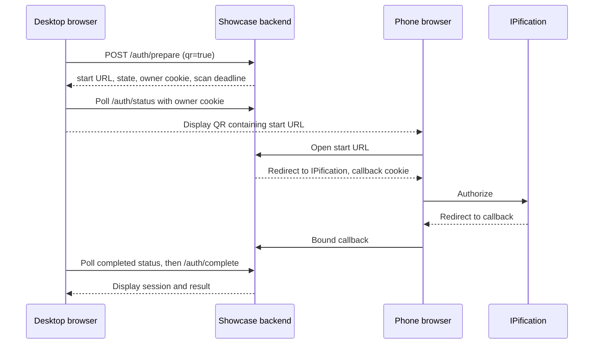

# Desktop QR flow

[Documentation home](../README.md) · [Browser authorization](browser.md)

QR lets the desktop initiate an attempt and a phone open its authorization URL. It is a showcase presentation and state-recovery mechanism, not a separate IPification API.

An unstarted QR has two minutes to be scanned; the first successful start opens a separate five-minute completion window. The initiating desktop immediately polls `/auth/status` and then every two seconds, using its owner cookie and the same origin. The phone receives a different callback binding. Knowing `state` alone does not normally grant status access. Refreshing or closing the dialog cancels the active UI attempt; expired codes can be regenerated. [QR UI](../../src/features/qr/qr-dialog.tsx) · [Polling](../../src/features/auth/auth-status.ts) · [Attempt lifecycle](../../src/server/auth/attempts.ts)

Use the Network URL printed at startup and verify the phone can reach it. `localhost` in a QR points to the phone, not the desktop. Provider registration must allow the actual callback URL. The single-process memory store means restart loses the attempt; separate showcase processes do not share it. The browser tests use a mock provider and two browser contexts, not a physical phone or carrier.
