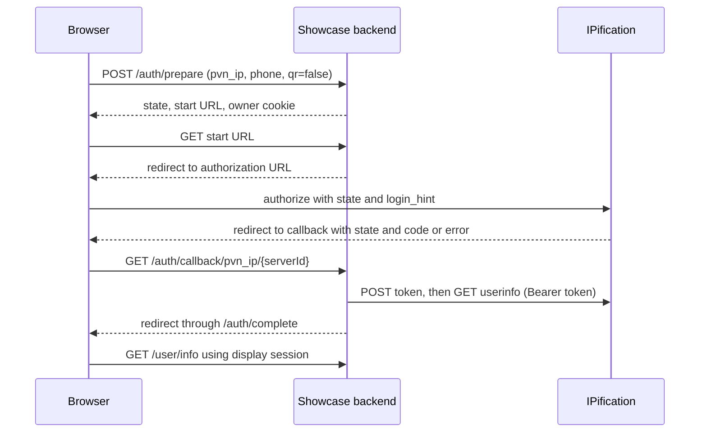

# Browser authorization: PNV, Login and Identity

[Guide home](README.md) · [QR](qr.md) · [Endpoint reference](api.md)

## Methods and inputs

| Screen | Configured `user_flow` values | Showcase behavior |
| --- | --- | --- |
| PNV | `pvn_ip`, `pvn_ip_plus`, `pvn_im`, `pvn_ipificator` | Requires the entered phone; passes it as `login_hint` |
| Login | `login_ip`, `login_ip_plus`, `login_im` | Does not ask for a phone |
| Identity | `anonymous`, `kyc_phone` | Anonymous omits the phone; KYC requires it |

SIM and SMS use separate [SIM](sim.md) and [SMS](sms.md) paths. Availability, client ID, scope, channel and server are configuration-dependent; IP and IP+ use the same redirect machinery with their own configured client and scope. IP via App uses the special IPificator authorization endpoint and is offered on mobile by the showcase. IM navigates directly, including on desktop; other supported desktop browser methods use QR. See [flow catalog](../../src/shared/flow-catalog.ts) and [frontend entry points](../../src/features/login/use-verification.ts).

## PNV via IP: end to end



1. Configure an auth server and a `pvn_ip` client with the provider-issued credentials and scope. Register the exact callback for the origin and server being used: `{origin}/auth/callback/pvn_ip/{serverId}`.
2. The browser submits a normalized phone in `phone` to the showcase. The demo creates an attempt and an HttpOnly owner cookie. Both the cookie and `state` must remain available to the initiating browser.
3. `/auth/start` builds the provider authorization request with `response_type=code`, `client_id`, `redirect_uri`, configured `scope`, `state`, a nonce, and, when present, `login_hint` and configured `channel`.
4. On callback the backend validates its attempt binding. A provider error is handled as an error; without an error, a code is required. It exchanges the code server-side with the same redirect URI, then retrieves userinfo. Never exchange the code with a client secret in browser code.
5. The showcase stores the result and creates a display session. `/user/info` shows returned userinfo; fields depend on the provider and granted scope.

Minimal browser example **for this showcase**, executed on its own origin:

```js
const response = await fetch('/auth/prepare', {
  method: 'POST',
  headers: { 'Content-Type': 'application/json' },
  credentials: 'same-origin',
  body: JSON.stringify({
    user_flow: 'pvn_ip', server_id: 'stage',
    phone: '+<country-code><number>', qr: false,
  }),
});
if (!response.ok) throw new Error('Could not prepare authentication');
const { url } = await response.json();
window.location.assign(url);
```

The backend uses [`openid-client`](https://github.com/panva/openid-client) for code exchange and userinfo. The app constructs its configuration from the configured Keycloak endpoints, uses `client_secret_post` at the token endpoint, then sends the access token as a Bearer header to userinfo. The library requires a conforming token response including `token_type` and a userinfo response containing `sub`. See [provider](../../src/server/auth/provider.ts) and [HTTP client](../../src/server/shared/http-client.ts).

```js
import * as oidc from 'openid-client';

// Run only on your backend, after validating the callback and state.
const config = new oidc.Configuration({
  issuer: issuerUrl, token_endpoint: `${oidcRoot}/token`,
  userinfo_endpoint: `${oidcRoot}/userinfo`,
}, clientId, clientSecret);
const tokens = await oidc.genericGrantRequest(config, 'authorization_code', {
  code, redirect_uri: callbackUrl,
});
// Use the validated ID-token subject when available and required by your flow.
const userInfo = await oidc.fetchUserInfo(config, tokens.access_token, expectedSubject);
```

The example omits required callback/state, nonce, ID-token and session checks. The showcase currently binds its callback to the attempt but does not validate an ID-token subject for comparison, so its helper uses `skipSubjectCheck`; customers should use their validated expected subject and their own complete OIDC security policy. SMS/SIM retain their existing CIBA-specific HTTP flow. Configuration requires HTTPS except for same-origin loopback test fixtures.

## Read the result correctly

Preserve the provider's userinfo response. `phone_number_verified` can be absent; absence is not a positive verification. If present, use the provider's documented type and meaning; the demo displays explanatory text whenever the field is present, including guidance for `true`, `false`, and other values. A demo display session alone is not proof of phone verification. The caller must apply its own verification policy to the provider result.

On provider `error` or `error_description`, the demo shows an error; if none and no code is supplied, it shows a generic failure. A code may be single-use: start a new attempt after a failed/expired flow instead of replaying a callback. Provider or network timeouts can also fail the exchange. Never put raw codes, tokens or sensitive userinfo into logs or shareable URLs.
