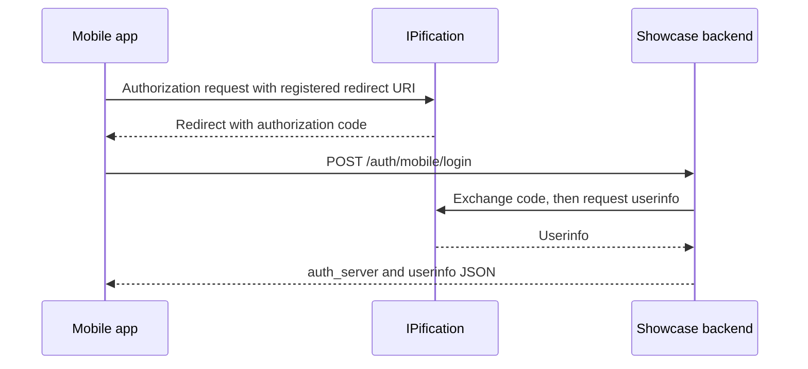
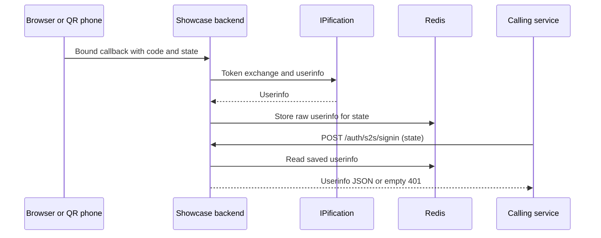

# Mobile code exchange and S2S result lookup

[Integration guide](README.md) · [Browser flow](browser-flows.md) · [HTTP reference](api.md)

These are **Showcase backend endpoints**, not IPification endpoints or a required SDK. Choose the operation that matches the information you already have:

| You have | Showcase request | Backend behavior |
| --- | --- | --- |
| An unused authorization `code` and its redirect URI | `POST /auth/mobile/login` | Exchange the code with IPification and request userinfo. |
| The `state` of a Showcase browser attempt whose callback has completed | `POST /auth/s2s/signin` | Read previously stored userinfo from Redis; no code exchange. |
| A desktop browser waiting for a QR attempt | `GET /auth/status?state=...` | Check owner-bound status. See [QR and polling](qr.md). |

## Mobile: exchange an authorization code

The mobile client first completes an authorization flow with a registered client and redirect URI, then sends its code to the Showcase backend. Configure the client ID and secret on the server; do not embed the secret in the mobile app.



Example request to the Showcase origin. The `redirect_uri` must match the authorization request and be accepted by the provider:

```http
POST /auth/mobile/login HTTP/1.1
Content-Type: application/json

{
  "client_id": "<configured-client-id>",
  "server_id": "stage",
  "code": "<authorization-code>",
  "redirect_uri": "<registered-redirect-uri>"
}
```

`client_id` selects a configured client; `server_id` selects a configured auth server. An omitted or empty `server_id` selects the first configured server. Expired, used or mismatched codes and redirect URIs can be rejected by the provider.

Example success response; claims vary by provider and scope:

```json
{
  "auth_server": { "id": "stage", "url": "<configured-auth-server-url>" },
  "sub": "<subject>",
  "phone_number_verified": true
}
```

The handler merges `auth_server` first and userinfo second, so a provider claim named `auth_server` takes precedence. It returns userinfo directly and does not create a browser session. The code-exchange helper uses `openid-client`: token response must include `token_type`, and userinfo must contain `sub`; userinfo uses a Bearer token. See [browser flow](browser-flows.md) for the current subject-validation limitation.

Unknown server returns 400; unknown client and provider failures can return 401. Do not infer the exact cause from status alone. Start a fresh authorization attempt if the code expired or was already used. Apply your own verification policy to provider claims; receiving userinfo does not itself prove phone verification.

## S2S: read an existing Showcase result

A successful Showcase browser callback must first exchange a code and store raw userinfo under that attempt's `state`. This endpoint cannot exchange a mobile authorization code, and `/auth/mobile/login` does not store a result for this lookup.



```http
POST /auth/s2s/signin HTTP/1.1
Content-Type: application/json

{
  "state": "<state-from-the-showcase-attempt>"
}
```

A successful read returns the cached raw userinfo without adding `auth_server`:

```json
{
  "sub": "<subject>",
  "phone_number_verified": true
}
```

A missing or expired result returns HTTP 401 with an **empty body**, so do not parse every response as JSON. A 401 can also mean the callback has not stored the result yet; it does not distinguish pending, failed and expired attempts. Results have a one-hour TTL and reads do not consume them. TTL is an upper bound, not a guarantee of availability.

Unlike `/auth/status`, this handler does not check an owner cookie or authenticated session; possession of `state` is sufficient for lookup. Protect it with appropriate service authentication and access policy, keep `state` confidential, and do not log or expose userinfo. Apply your own authorization and validation policy before using these demo endpoints in a customer system.

## Source and tests

- [Mobile handler](../../src/server/auth/mobile.ts) and [auth service](../../src/server/auth/service.ts).
- [S2S handler](../../src/app/auth/s2s/signin/route.ts) and [Redis result store](../../src/server/store/auth-results.ts).
- [Mobile and S2S contracts](../../tests/contracts/mobile-s2s.test.ts) and [web callback contracts](../../tests/contracts/web-auth.test.ts).
